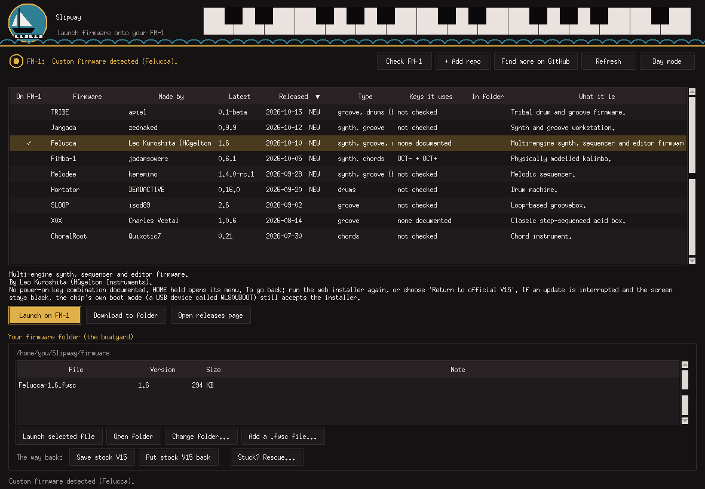
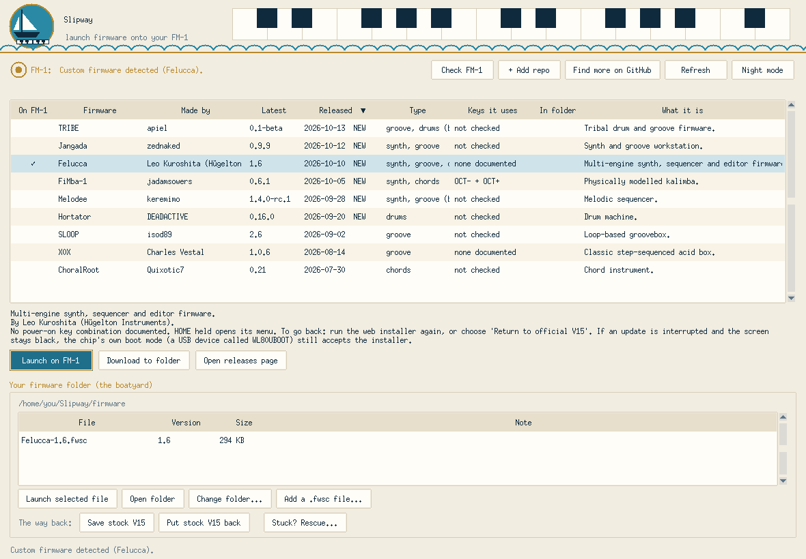

  

# Slipway

**Find, check and install custom firmware on your M-VAVE FM-1, from one small app for Windows and Mac.**

Slipway lists the community's FM-1 firmware with who made it, what it does and when it was released, checks the file,
and puts it on your FM-1 in a click. It always keeps a way back to the stock V15, and if something goes wrong it
walks you through getting the FM-1 running again, even from a black screen.

## What you get

- **A live list of firmware.** Author, version, release date, a **NEW** tag for the last 30 days, and which keys it
  uses. Click any heading to sort.
- **One-click install** through Felucca's own installer, with the file checked first.
- **Download to folder.** Files land in a "boatyard" folder you can see, and are never downloaded twice.
- **Stock first, every time.** A custom firmware only goes on after the official V15 is saved, and between two custom
  installs the stock V15 goes back first, so the way back is always clean.
- **Stuck? Rescue.** Step-by-step USB rescue that puts the stock V15 back.
- **A full recovery guide** for a black-screen FM-1 (the "WL82 UBOOT1.00" case), with two checked backups and a
  byte-for-byte verify. It includes a route for Windows PCs that answer "Access is denied".
- **Nautical, readable, quiet.** Night and day modes, plain warnings, and a ship's bell instead of the system chime.

  

## Install (Windows)
1. **Install Python** (free). Download it from [python.org/downloads](https://www.python.org/downloads/) and open it.
   On the **first screen** of the installer, tick the box **"Add python.exe to PATH"** at the bottom. It is not ticked
   by default, and Slipway can't find Python without it. Then click **Install Now**.
2. **Download Slipway.** Get **Slipway.zip** from [Releases](../../releases) and unzip it somewhere you want to keep it
   (right-click, *Extract All*).
3. **Double-click `install.bat`.** It sets up what it needs, makes a Desktop and Start-menu shortcut with the sailboat
   logo, and starts the app. If Windows says "Windows protected your PC", click **More info**, then **Run anyway**.
4. Next time, just use the shortcut.

> **About V16:** M-VAVE's download page now labels the official firmware *V16*. The file Slipway was tested with (`FM-1_1.fwsc`, 699,956 bytes, SHA-256 `db1642b2...edb8a`) is byte-for-byte identical to V15 and reports itself as `FM-1_015`, so Slipway accepts it as the official stock file. Slipway checks the file's contents, not its name or the number on the website. If M-VAVE ever publishes a file that really differs, Slipway will refuse it as stock until support is added.

## Install (Mac)
> Tested on a real Mac: a MacBook Air (Apple silicon, Python 3.15 from python.org): app, firmware list, FM-1 detection, put stock V15 back and install a custom firmware all worked. Not yet tried on an Intel Mac - please [open an issue](../../issues) if anything goes wrong.

1. **Install Python** from [python.org/downloads/macos](https://www.python.org/downloads/macos/) (open the installer and
   click Continue). Apple's built-in python3 is too old; Slipway skips it. Homebrew: `brew install python python-tk`.
2. **Download Slipway.zip** from [Releases](../../releases) and unzip it somewhere you want to keep it.
3. **Right-click `install.command` -> Open -> Open.** (A plain double-click is refused the first time because the script
   is unsigned. Still blocked? System Settings -> Privacy & Security -> *Open Anyway*.) It sets up a private
   environment, makes the firmware folder, adds **Slipway** (with the sailboat logo) to your Applications folder and starts it.
4. Next time, open Slipway from Spotlight or Applications.

**If something goes wrong on a Mac**
- *"could not be executed / no access privileges"*: the files lost their executable flag (this happens with GitHub's green *Code* download). Use the zip from *Releases*, or in Terminal: `cd` into the Slipway folder, then `chmod +x install.command run_slipway.command` and `./install.command`.
- *"Apple could not verify ... is free of malware"*: the scripts are unsigned. Try to open once, then System Settings -> Privacy & Security -> *Open Anyway*. If instead it says the file *will damage your computer* with only a Bin button, do not override it: [open an issue](../../issues).
- *"The MIDI libraries did not install" / messages about a compiler*: type `xcode-select --install` in Terminal, let it finish, then run `install.command` again.
- *"Couldn't reach GitHub" although you are online*: python.org's Python needs its certificates step; `install.command` now runs it for you. If you installed Python afterwards, open *Applications -> Python 3.x -> Install Certificates.command*.
- *The FM-1 is not found*: use a USB **data** cable, switch the FM-1 on first, allow the accessory if macOS asks (System Settings -> Privacy & Security -> *Allow accessories to connect*), then press *Check FM-1*.
- On Apple-silicon Macs Slipway now always starts natively. If you see an "incompatible architecture (have 'arm64', need 'x86_64')" error, run `./install.command` again.

The black-screen USB recovery tool does not support macOS: use a Windows/Linux PC or a Linux virtual machine
(see the in-app recovery guide, *Plan C*).

> **Need more detail?** The full, step-by-step guide is **[README.txt](README.txt)**: how the list works, safety
> confirmations, the firmware folder, Stuck? Rescue, and what to do if your FM-1 shows a black screen.

## Safety
Flashing firmware can leave a device unusable. Slipway installs only through Felucca's own installer, and the recovery
guide always takes two checked backups first. Use it at your own risk. Slipway is not made by or affiliated with
M-VAVE or the Felucca project.

## Licence and credits
MIT, see [LICENSE](LICENSE). Everything Slipway relies on is credited in [CREDITS.md](CREDITS.md).

Sound: the ship's bell is ["Ship Bell Two Chimes"](https://pixabay.com/sound-effects/film-special-effects-ship-bell-two-chimes-102730/)
by Sojan (Freesound, via Pixabay), used under the [Pixabay Content License](https://pixabay.com/service/license-summary/).
It is not covered by Slipway's MIT licence.
